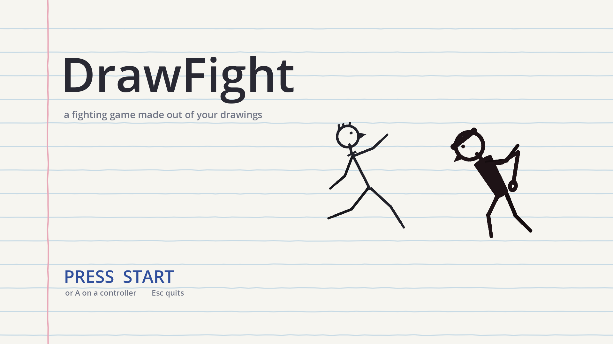
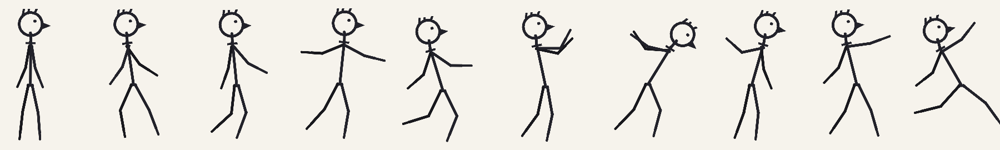
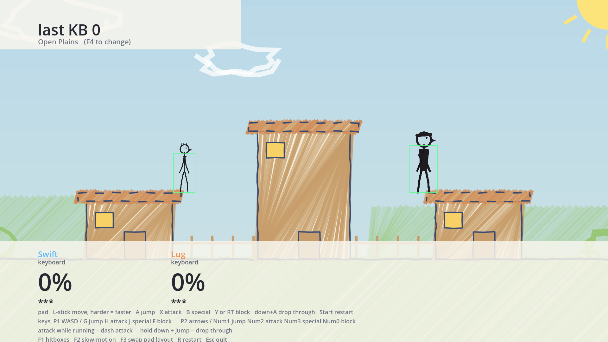

# DrawFight

**A Super Smash Bros.-style platform fighter where every character is a drawing made by a kid.**

You draw a character on paper or on a tablet. It gets cut into pieces, hung on a skeleton, and
put in a fighting game. Then it runs, jumps, and knocks other people's drawings off the screen.



---

## The trick

One drawing, sliced into body parts, animated as a paper puppet:



That drawing was never redrawn, traced or cleaned up. Those are the same pixels, rotated about
their joints — which is the entire point of the project. If a limb is lumpy, the limb is lumpy
in the game.

**Every fighter rigs to the same skeleton**, so the animation library is authored once and
inherited by all of them. Adding a character is an afternoon of cutting up a photo, not a week
of animating. That single decision is what makes the project survivable: if a new drawing took a
weekend to get in the game, a kid would draw three characters and stop.

---

## Status

Playable, and nowhere near finished. Nothing in it has been balanced by anyone who has actually
played it.

| | |
|---|---|
| **Fighting** | percent + knockback + stocks, hitlag, screen shake, DI, ledge grabs, dodges |
| **Moves** | 17 per fighter — a jab combo (length set by weight), 3 tilts, 3 chargeable smashes, dash attack, 5 aerials, 4 specials, each with its own animation |
| **Fighters** | 6 — **Circy**, the first fighter designed by a kid (Elim), and **Triguy**, his second, sent in through the submission form; **EdgeLord**, a sword fighter drawn by Eric and coloured by us; **DoomBot**, a rogue factory robot drawn and designed by Eric, with a furnace that heats up as he fights; and two stand-ins we drew in code: **Flambé**, a punk rocker, and **Lugnut**, a muscle-bound construction worker |
| **Players** | 2 to 4 in versus, any of them the computer, everyone for themselves or in teams (red, blue, green; no friendly fire); each player's colour and number on their cursor, the HUD and a tag over their head |
| **Stages** | 7 — Fridge Door, Open Plains, City Rooftops, and Big Show: a concert stage with a girder across the top, speakers loud enough to knock you back and a crowd below that cheers every KO; and three big ones for three or four players: Playground (slide, monkey bars, sandbox, swings), Building Site (a pit in the middle, cranes swinging their loads in and out, scaffolding) and Kitchen Counter (a sink to drop into, a toaster, cupboards) |
| **Items** | 30, all art supplies — a giant pencil to swing, a paint bucket to throw, glitter bombs, a magic marker that draws a platform, White-Out that rubs off damage. Off, low, medium or high from the Items button on fighter select or stage select, and each one on or off from stage select. Story fights always drop them on low |
| **Drawing** | draw a fighter in the game itself, on lined paper: marker, coloured pencil, paint bucket, eraser, layers (one per body part) and pages for the things a fighter uses. Saved as you go, and sent straight to ecec.dev - the same place as the website's form |
| **Story** | six stories, one per fighter, each an opening, five fights (one of them two-on-one), the DoomBot finale and an ending - and DoomBot's own, against DoomBot Mk. II. Speech bubbles, a narrator, reaction poses, a directed camera, all played by the real fighters on the real stage. The fights get harder as a story goes on, and its map sets how hard (Easy, Medium or Hard) and lets you replay any chapter you have reached; progress is saved, with a gold star for every story finished |
| **Screens** | title, main menu, options, character select, stage select, item settings, match; your drawings, the drawing screen, sending it in |
| **Input** | Xbox pads (hot-pluggable), and keyboard and mouse for one player |
| **CPU** | a computer opponent, for playing alone - Easy (a sparring partner a small child can beat up), Medium or Hard (knows its combos) - and in story mode, teams of them, getting tougher fight by fight |
| **Sound** | a sound for every attack and hit, the countdown, KOs and menus; chill menu music, every stage's own battle music (guitar rock at the Big Show, industrial on the Building Site...), story and DoomBot music and a victory sting — all generated by code |
| **Not yet** | the art import tool, results screen, volume settings |

Flambé (Swift) and Lugnut are **scaffolding, not content** — see [`fighters/README.md`](fighters/README.md).
They exist so the engine could be built and played before any real drawing existed, and they get
deleted when real ones land. Circy and Triguy are the real thing: designed and drawn by Elim,
and cut straight from Elim's drawings without a line redrawn. EdgeLord and DoomBot are drawn by Eric;
EdgeLord is Eric's drawing, coloured in by us, swords and all.

---

## Playing it

Download it from **<https://ecec.dev/drawfight/download>** (Windows). It keeps itself up to
date: every time it starts, it checks for a new version and installs it.

## Running it from source

Needs [Godot 4.5.1 **Mono**](https://godotengine.org/download) (the C#/.NET build) and .NET 9.

```sh
dotnet build DrawFight.sln     # ~2s, catches essentially all C# errors
"$GODOT_BIN" --path .          # run it
```

Handy flags — each boots straight to one screen and can screenshot itself:

```sh
"$GODOT_BIN" --path . -- --match --stage=1   # skip the menus
"$GODOT_BIN" --path . -- --draw --windowed  # straight to the drawing screen
"$GODOT_BIN" --path . -- --parade --shot=70  # every fighter in every animation
"$GODOT_BIN" --path . -- --parade --attacks --shot=70  # every fighter's attacks at the moment they hit
"$GODOT_BIN" --path . -- --shot=120          # screenshot after 120 frames, then quit
```

## Controls

| Xbox pad | |
|---|---|
| left stick | move — **the harder you push, the faster you run** |
| A or Y | jump, double jump - the double jump is also the only way to turn round in the air |
| X | attack — tap repeatedly for a jab combo; hold a direction for tilts and aerials; **flick** the stick with it for a smash (hold X to charge); while running, a dash attack |
| d-pad + X | a smash attack in that direction, every time — hold X to charge it |
| right stick | a smash attack that way (hold it out to charge); an aerial that way in the air |
| B | special (+ a direction for all four). After an up special you can only drift until you land (Triguy can still attack after his trampoline) |
| LT or RT | block, behind a shield — reduces damage and knockback, never negates it |
| RB, or LT/RT + X | grab — catches someone even while they block; then the stick picks a throw |
| LT/RT + stick | roll, spot dodge, air dodge |
| LB | taunt — a pose and a line, three each (stick up, sideways or down picks one); does nothing but show off, and leaves you open |
| X beside an item | pick it up. With one in hand, X uses it — swings it, throws it, sprays it, drinks it in |
| RB holding an item | throw it, the way the stick points (down on the ground sets it down) |
| hold ↓ | crouch (ducks high attacks); attack from it for a low sweep. Hold ↓ and push left or right to crawl along slowly, still ducking |
| hold ↓ + A | drop through a soft platform |
| hold ↓ in the air | fall faster |
| F11 | the game starts fullscreen; F11 switches to a window and back |

Keyboard and mouse (P1): `W` `A` `S` `D` or the arrows to move, `Space` jump, left click or `J`
attack, right click or `K` special, `Shift` or `L` block, `E` or middle click grab, `Q` taunt,
`Enter` pause, `Escape` back (in a match, pause; on the main menu it asks to quit). The mouse only fights in a match. One player
on the keyboard; everyone else needs a pad. Options > Controls lists all of it.

After **Start**, the main menu: **Versus**, **Story** or **Draw your own** (a fighter or a
stage), with **Report a bug** up top for telling us what went wrong. The
mouse is only for the drawing screens; everywhere else it does nothing and its pointer is hidden,
and even there it only shows once you move the mouse.
In menus, each player presses **A** to join, then drags a cursor with the left stick and presses
**A** to pick; **B** takes a pick back. A controller's cursor appears once it is touched, and
whoever picks **Versus** is already sitting as Player 1. **QUIT** is on the main
menu and the fighter select screen. In a story scene, **A** hurries the line on and **holding
B** skips the scene.

**Options** - the gear beside QUIT: fullscreen or a window, music and sound volume, the pad's
button layout (Standard or Smash), screen shake, how many lives a versus fight starts with, and
**What's new** - every version's changes.
Every name saved on this computer is listed there too; press one twice to delete it.

**Names** - on fighter select, **Name** in your seat lets you pick a saved name or spell a new one
(or type it, playing on the keyboard). It shows over your head and under your percent.

**Team colours** - in a team fight each fighter's own colour turns to their team's (EdgeLord's red
goes blue on blue), so teams read from across the stage.

**The drawing screen** is for a mouse, a pen or a touch screen; a pad's stick moves a cursor and
holding **A** draws, **B** undoes. Only one points at a time: whichever you used last. Touch the
pad and its cursor appears where the mouse was (that first touch does nothing else) and the
mouse pointer hides; move the mouse and the pad's cursor goes. The same on your drawings and on
sending one in.

| Drawing | |
|---|---|
| draw / right-click | use the tool / pick up the colour under the pointer |
| wheel / middle-drag or Space-drag | zoom / move the page about |
| `M` `P` `G` `E` `I` `V` | marker, pencil, bucket, eraser, pick, move |
| `[` `]` | smaller, bigger |
| Ctrl+Z, Ctrl+Y, Ctrl+S | undo, redo, save (it saves by itself too) |
| a pen turned round | its eraser rubs out |

**Up to four players:** fighter select has four seats, and players are numbered in the order
they press **A**: the first to press is Player 1, whatever they are holding, the next Player 2, and
so on. Any pad counts, and so does the keyboard (one player).
**B** with nothing picked gets up out of the seat. Any seat can be the computer instead:
**CPU** puts it there; on a CPU's seat, **EASY / MEDIUM / HARD** sets how well it plays, **CHANGE** cycles its fighter and **REMOVE** takes it out; with every seat
taken, someone new pressing A takes a CPU's. Two or more seats filled and picked, and **Start**
fights. **Playing alone** is the same:
press **CPU** in another seat.

**Teams:** press **Everyone for themselves** at the top of fighter select to switch to
**Teams**. Each seat gets a team button - red, blue or green; press yours to change it (anyone can
change a CPU's). Teammates can't hurt each other, and a team wins when the other teams are out.

In a match, **Start** pauses: resume, pick fighters, or go to the main menu (in a story, its map or the main menu). In any menu, **B** steps back a screen at a time, as far as the main menu.
Keyboard extras: `F1` hitboxes, `F2` slow motion, `F3` swap pad layout, `F4` cycle stage, `R` restart.

---

## Three ideas the whole codebase rests on

**One skeleton, shared by everyone.** `RigBone` *is* the skeleton. Every fighter has exactly
those bones, so one animation library drives all of them. A drawing's parts are stored in a
canonical orientation — limbs pointing straight down — so a bone rotation of zero means the same
thing for every fighter regardless of the pose it was drawn in.

**Everything is an integer frame count.** The game logic runs at a fixed 60 Hz and no duration
is ever a float in seconds. Startup, active frames, endlag, hitstun, buffers — all frames. That
is what makes moves feel consistent and balance arguments concrete, and retrofitting it would
mean rewriting every move.

**A stage is data, not a renderer.** There is one stage renderer for the whole game. A stage is
a palette, a list of rectangles and a list of props in `StageCatalog.cs`. If adding one seems to
need new drawing code, the data model is wrong.



---

## Adding content

**A fighter** — put its parts and a `rig.json` under `fighters/<name>/`, then add an entry to
`FighterCatalog`. Pick a weight class (Light / Medium / Heavy) and it inherits ten retuned
normal attacks automatically; only the **four specials** are authored per character, because
those come from the kid's own description of what their fighter does.

**A stage** — one entry in `StageCatalog`: a palette, some rectangles, some props. No drawing
code.

**Checking your numbers** — `RegressionChecks` runs on every boot and prints the percent at
which each move starts KOing, by simulating the launch. Read it before and after touching any
knockback number. It has already caught a swing that killed at 50% and a jab that caused 38
frames of hitstun.

---

## Layout

```
scripts/        all the code, flat — engine, rig, stages, screens, tools
scenes/         one 2-line .tscn that attaches GameRoot; everything else is built in code
fighters/       one folder per fighter: source art, sliced parts, rig.json
tools/art/      the cut scripts for every drawn fighter, and the generators for the two stand-ins (Python 2.7 + PIL)
tools/audio/    the generators for every sound effect and all the music (Python 2.7)
assets/         generated sound (assets/sfx/) and music (assets/music/) - never hand-edited
.ai/            design docs — the source of truth for anything design-shaped
for-nephew/     written for a 10-12 year old, not for developers
```

### Design docs

`.ai/` is where decisions live, and why. Worth reading before changing anything design-shaped:

- [`project-overview.md`](.ai/project-overview.md) — the pitch and the five pillars
- [`fighting-design.md`](.ai/fighting-design.md) — the combat contract, the knockback formula
- [`art-pipeline.md`](.ai/art-pipeline.md) — how a photo becomes a rigged fighter
- [`art-direction.md`](.ai/art-direction.md) — crayon and marker, and why night is lavender
- [`audio-direction.md`](.ai/audio-direction.md) — how every sound is made, and how loud
- [`character-design.md`](.ai/character-design.md) — a kid's description → a balanced moveset
- [`releasing.md`](.ai/releasing.md) — the download, and how it updates itself
- [`roadmap.md`](.ai/roadmap.md) — what is built and what is deliberately deferred

---

## For the kids

[`for-nephew/`](for-nephew/) is written for a 10–12 year old: how to draw a fighter so it can
actually be rigged, and a character sheet to fill in. There is a nicer illustrated version of
the guide [here](https://claude.ai/artifact/DmdTZS491FFJs28Cj8g5qL).

The most important question on the character sheet is **"what is your fighter TERRIBLE at?"** —
asked before anything is built. A kid designing a fighter will make it fast *and* strong *and*
tough; a kid asked what it is bad at will cheerfully invent a weakness, because weaknesses are
characterful and they know that already. That question does the balance work and is disguised
as the fun one.

---

## A note on the art

This repository is public, but the drawings in it are not up for grabs.

Any real child's artwork in `fighters/` belongs to the child who drew it. **Circy and Triguy are
Elim's** — the characters, the names, the moves, and every drawing under `fighters/circy/` and
`fighters/triguy/` — and are shared here so people can see the game, not for reuse. Please don't copy the drawings into anything
else.

The same goes for **EdgeLord and DoomBot, which are Eric's** - the drawings under
`fighters/edgelord/` and `fighters/doombot/`. Flambé (Swift) and Lugnut are
script-generated and carry no such claim. No licence has been chosen for the
code yet; until one is, the default applies and it is all rights reserved.
